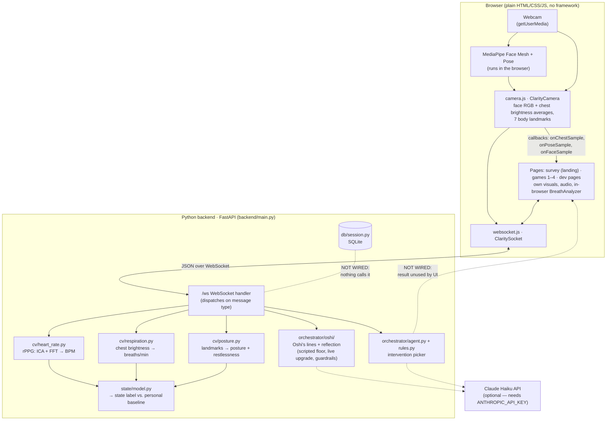
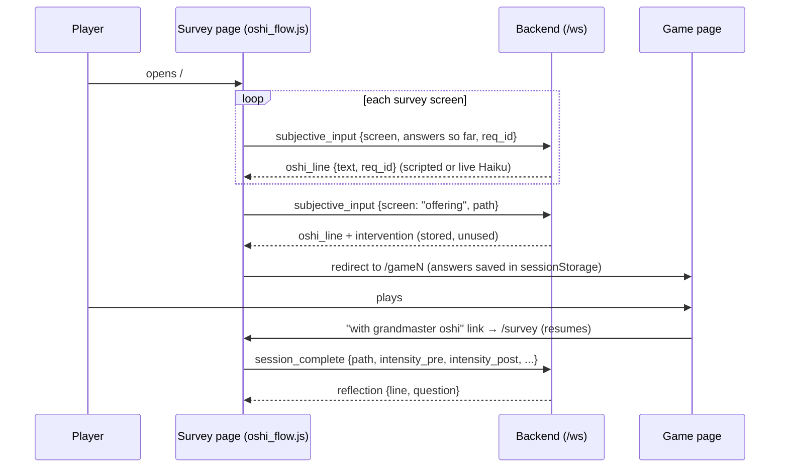

# Architecture

How the parts of Clarity Loop fit together at runtime. For the message
formats, see [`CLAUDE.md`](../CLAUDE.md#websocket-messages); for how to add
things, see [EXTENDING.md](EXTENDING.md).

## The big picture

Dashed lines are optional or not connected. See [KNOWN_ISSUES.md](KNOWN_ISSUES.md) #1–#2.

## Two loops

The app runs two mostly independent loops over the same WebSocket.

### 1. The sensing loop (continuous, about once per second)

1. `ClarityCamera` averages the face patch (R/G/B) and chest patch
   (brightness) at ~15 frames/s. Every ~1 s it sends the last 128 frames as
   `hr_data`. MediaPipe Pose landmarks go out as `pose_data` at ~5/s.
2. `main.py` runs the heart-rate and breathing detectors, adds the latest
   posture, updates this user's `PhysiologicalStateModel`, and replies with
   `hr_result` (BPM, breathing rate, posture, state label, baseline).
3. Pages use what they need. In practice:

   | Page | Uses from `hr_result` |
   |---|---|
   | `/dev/signals` | everything (it's the dashboard) |
   | `/game1` | `posture.restlessness` (a motion gate on progress) |
   | `/game3` | `signal_quality` |
   | `/game4`, `/dev/observe`, `/dev/mirror` | nothing (camera callbacks only) |
   | `/game2`, `/` (survey) | not connected to the camera |

   Most breath-driven visuals come from the **in-browser** `BreathAnalyzer`,
   not from the backend. It reacts instantly and works at very slow
   breathing rates that the backend's FFT can't resolve.

### 2. The survey loop (event-driven)

## State: where it lives

| State | Lives in | Scope |
|---|---|---|
| Heart-rate / breathing detectors | `main.py` module level | shared by all users (they're stateless) |
| Intervention picker + its cooldown | `main.py` module level | **shared by all users** (known issue #9) |
| Baseline, posture window, BPM median, Oshi narrator, survey answers | inside `websocket_endpoint` | one per WebSocket connection |
| Survey progress across page loads | browser `sessionStorage` (`clarityLoop.survey.v1`) | one browser tab |
| Mute preference | browser `localStorage` (`clarity.muted`) | the browser |

A page reload opens a new WebSocket, so the backend baseline starts over.

## Privacy by construction

- Raw video never leaves the browser. Only averaged numbers and landmark
  coordinates are sent.
- When an API key is set, Claude Haiku receives survey answers (sensation,
  body region, emotion, intensity), the state **label**, and time of day.
  It never receives raw signals or video.
- Nothing is stored on the server today. The SQLite store is not wired.

## Design constraints that shape the architecture

- **Works with no API key.** Every Haiku call has a scripted or rule-based
  fallback, and no call is allowed to raise into the socket loop.
- **Degrades gracefully.**
  - Games 3 and 4 run on their own clock from t=0, even with the camera denied.
  - Game 1 waits for a short breath calibration.
  - A poor signal freezes visual reactions instead of making them jitter.
- **Relative, not absolute.** rPPG BPM drifts, so state is judged by change
  from the person's own baseline.

The full design rules are in [CLAUDE.md](../CLAUDE.md#design-rules-binding).
