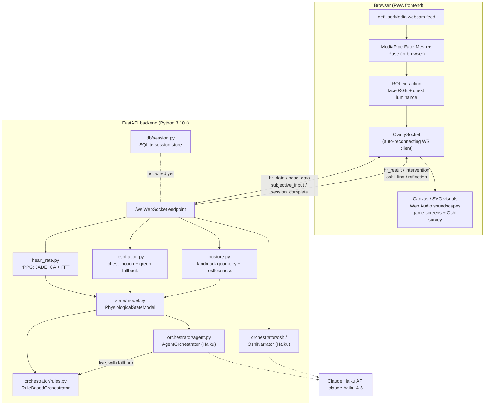

# Clarity Loop — Project Overview

*A detailed tour of every component and game. For a quick start see the
[README](../README.md); for the runtime diagram see [ARCHITECTURE.md](ARCHITECTURE.md);
for extending the app see [EXTENDING.md](EXTENDING.md). Unfamiliar terms:
[GLOSSARY.md](GLOSSARY.md).*

> A 7-week faculty capstone PWA for real-time biofeedback and emotional regulation.
> Clarity Loop makes the body's physiology visible — heart rate, respiration, posture —
> through nothing but a webcam, and delivers adaptive, AI-guided micro-interventions
> voiced by a calm forest sage named **Grandmaster Oshi**.
>
> The system is deliberately *not* a productivity tool. It is designed to feel like
> "a space you enter where your body becomes visible" — periphery-of-attention,
> non-diagnostic, and somatically led.

---

## 1 · Project Overview & Architecture

Clarity Loop runs entirely on commodity hardware: a browser captures the webcam feed,
extracts lightweight per-frame signals in JavaScript, and streams them over a WebSocket
to a Python backend that performs the heavy signal processing. Derived physiological
state feeds an **agentic orchestrator** (Claude Haiku) that selects an intervention and
narrates it in Oshi's voice — always with a rule-based fallback so the whole experience
works with **zero API access**.

### Languages used

| Language | Where | What it does |
|---|---|---|
| **Python** (3.10+) | `backend/` | The whole server: FastAPI app + WebSocket endpoint, the CV signal-processing pipelines (rPPG, respiration, posture), the physiological state model, both orchestrators (rules + Haiku), the Oshi narration package, and the SQLite session store. |
| **JavaScript** (vanilla, no framework) | `frontend/js/` | Everything in the browser: webcam capture and ROI extraction, driving MediaPipe, the auto-reconnecting WebSocket client, the app/game state machines, the `BreathAnalyzer`, and all Canvas/animation rendering. |
| **HTML** | `frontend/*.html`, `frontend/dev/*.html` | Page structure for the Oshi survey (landing page), four game screens, and the developer pages. |
| **CSS** | `frontend/css/main.css` | All styling and the animation keyframes. |
| **SQL** (SQLite dialect) | `backend/db/session.py` | Schema definition and queries for the session-record store. |
| **Markdown** | `docs/`, `CLAUDE.md`, Oshi persona | Documentation, integration handoffs, and — notably — Oshi's persona/soul is authored in Markdown and loaded verbatim as the LLM system prompt. |
| **Dockerfile / YAML** | `Dockerfile`, `docker-compose.yml` | Container build and deployment configuration. |

At a high level it is a **Python backend + vanilla-JavaScript frontend** split: Python does
the numerical and AI heavy lifting, JavaScript does capture and presentation, and they talk
over a WebSocket using **JSON** as the wire format. The deliberate absence of a frontend
framework (React/Vue/etc.) keeps the client lightweight and dependency-free.

### High-level architecture



*Not wired yet:* the intervention picker's result is ignored by the UI, and
nothing writes to SQLite. See [KNOWN_ISSUES.md](KNOWN_ISSUES.md) #1–#2.

### Data flow, in words

1. **Capture (browser).** `camera.js` (`ClarityCamera`) runs MediaPipe Face Mesh + Pose
   locally and extracts two ROIs every frame at ~15 fps:
   - **Face ROI** (forehead + cheeks) → per-frame **RGB channel averages** for heart rate.
   - **Chest ROI** (shoulders/upper torso) → per-frame **luminance averages** for respiration.
   MediaPipe Pose runs in parallel at ~5 fps, forwarding seven front-view landmarks
   (nose, ears, shoulders, hips) for posture.
2. **Stream.** A 128-frame buffer is sent as `{type:"hr_data", r, g, b, chest, fps}`
   about once per second; pose landmarks are sent as `{type:"pose_data", landmarks}`.
3. **Process (backend).** `main.py` routes each message to the CV detectors, smooths BPM
   with a rolling median, and pushes HR/RR/restlessness/slump into the
   `PhysiologicalStateModel`, which emits a single **state label**
   (`elevated` / `settling` / `settled` / `dissociated` / `unknown`).
4. **Reply.** The server returns an `hr_result` carrying `bpm`, `rr_bpm`, a `posture`
   block, `signal_quality`, `state`, and the locked `baseline`.
5. **Orchestrate.** `OshiNarrator` supplies the spoken voice for every
   survey/retrospective screen. On the "offering" screen the `AgentOrchestrator`
   also asks Haiku to pick **one** intervention + experiential reasoning (falling
   back to the `RuleBasedOrchestrator`), but the UI doesn't use that pick yet. The
   player chooses a game directly.
6. **Persist (not wired).** `db/session.py` can store completed sessions in
   SQLite, but nothing calls it yet.

### Runtime surfaces (routes)

| Route | Purpose |
|---|---|
| `/` (also `/survey`) | **Oshi Survey & Retrospective**, the landing page: pre/post subjective flow |
| `/game1` | **Phoenix Ascent**: breath-driven flame (CV leads) |
| `/game2` | **Grandmaster's Count**: ambient bird-call counting meditation |
| `/game3` | **Follow the Flame**: 4·4·4·4 box-breathing pacer |
| `/game4` | **Tap the Tide**: guided EFT tapping session |
| `/dev/signals` | Developer: live dashboard of every signal (`frontend/dev/signals.html`) |
| `/dev/observe` | Developer, **Observational Mode**: landmarks + breath/restlessness waveforms |
| `/dev/mirror` | Developer, **Mirror Mode**: breath rendered as a responsive fire animation |
| `/ws` | WebSocket endpoint (all real-time traffic) |
| `/health` | Liveness probe |

---

## 2 · Tech Stack

| Concern | Choice |
|---|---|
| Backend framework | **FastAPI** + **Uvicorn** (async WebSocket server) |
| Real-time transport | Raw **WebSocket** (`/ws`), JSON messages |
| Signal processing | **NumPy** + **SciPy** (Butterworth filters, FFT, detrend) |
| Blind source separation | **JADE ICA** (`jade.py`, adapted from the rPPG reference) |
| Computer vision (client) | **MediaPipe** Face Mesh + Pose (runs in-browser via CDN) |
| AI orchestrator | **Claude Haiku** (`claude-haiku-4-5-20251001`) via the `anthropic` SDK |
| Config / secrets | **python-dotenv** (`ANTHROPIC_API_KEY`) |
| Frontend | Vanilla **HTML/CSS/JS** (no framework), Canvas 2D visuals |
| Frontend audio | **Web Audio API** (synthesized chimes, ambient crossfades) |
| Storage | **SQLite** (one row per completed session) |
| Deployment | **Docker** + **docker-compose** (Python 3.11-slim image) |

**Notable design decision:** the CV inference (MediaPipe) runs **client-side**; only
compact numeric buffers cross the wire. The backend does no video decoding — it receives
already-reduced RGB/luminance/landmark arrays, which keeps the server light and privacy
-preserving (raw video never leaves the browser).

### Local run

See the [README quick start](../README.md#quick-start).

---

## 3 · Technologies Used & How

### 3.1 Computer Vision — remote physiological sensing

**Heart rate (rPPG) — `backend/cv/heart_rate.py`**
Remote photoplethysmography: as blood volume pulses through facial capillaries, the
average color of the forehead skin oscillates at the cardiac frequency. The pipeline:
1. Build a 3×N matrix of normalized R/G/B channel averages.
2. Run **JADE ICA** (`jade.py`) to blind-source-separate the blood-volume-pulse signal
   from lighting/motion noise into three independent components.
3. Apply a **Hamming window**, then select the component with the highest
   total-power/peak-power ratio (the most periodic one).
4. Take the **FFT peak** inside the 0.75–3.33 Hz band (45–200 BPM) → BPM, with an
   **SNR** measure driving `signal_quality`.
The absolute BPM is treated as unreliable (rPPG drifts), so the system **trusts
change relative to the person's baseline, not the absolute number**. `main.py` further smooths BPM
with a rolling median and rejects jumps > 40 BPM.

**Respiration rate — `backend/cv/respiration.py`**
Two-tier signal:
- **Primary:** chest-ROI mean **luminance** oscillates as the chest rises/falls.
- **Fallback:** the **green channel** of the face ROI carries a weaker respiratory
  modulation when the chest isn't visible.
The signal is **linearly detrended**, bandpass-filtered to 0.15–0.5 Hz (9–30 BPM) with a
numerically stable 4th-order Butterworth in **SOS form**, then FFT-peak-picked. Thresholds
(RR band floor, SNR cutoff) were tuned against live validation data.

**Posture & restlessness — `backend/cv/posture.py`**
MediaPipe Pose landmarks (computed in the browser) are streamed as seven front-view points.
The backend derives, in normalized image space (no calibration — only *change* matters):
- `forward_head_lean` — nose vs. shoulder-midpoint height
- `slump_score` — hip-midpoint vs. shoulder-midpoint height
- `shoulder_asymmetry` — bracing / hiked shoulder
- `head_tilt_deg` — ear-to-ear line angle
- `restlessness` — mean per-coordinate stdev over a rolling ~6 s window, scaled to [0,1]
A visibility gate degrades gracefully to `upper_body_only` when hips leave the frame.

**Physiological State Model — `backend/state/model.py`**
Fuses HR + restlessness + slump into one label the orchestrator reasons against:
`elevated` (sympathetic activation), `settling`, `settled`, `dissociated` (withdrawn ≠ at
ease), or `unknown`. HR is always compared as a **fractional delta from a locked baseline**
(the drift-robust rule again). A short "live window" (~5 s) reacts to transitions while the
baseline is averaged over a full ~30 s window.

### 3.2 Agentic Orchestration with the Haiku API

There are **two independent Haiku call sites**, deliberately kept separate:

**(a) Intervention selector — `backend/orchestrator/agent.py`**
`AgentOrchestrator.recommend()` sends the physiological state + subjective survey answers
+ recent session history to Haiku and asks for **JSON only**:
`{intervention_id, params, reasoning}`. Guardrails:
- 3 s timeout; **rule-based fallback** on missing key, missing SDK, timeout, malformed
  JSON, unknown `intervention_id`, or a repeated pick (cooldown).
- Both the live path and the fallback return the **same `OrchestratorResult` shape**, so
  callers never branch.
- A salvage JSON parser tolerates stray ``` fences and remaps a stray `narration` key back
  to `reasoning` (avoiding a known `TypeError` trap).
- The system prompt forbids clinical/quantified language ("anxiety", "bpm", "fix",
  "optimize"…) and demands sensory/spatial metaphors.

**(b) Oshi narrator — `backend/orchestrator/oshi/`**
A self-contained package that voices **Grandmaster Oshi** on every survey/retrospective
screen. It is a **two-layer voice**:
- **Layer 1 (scripted):** an always-available line ships instantly, zero API.
- **Layer 2 (live Haiku):** if a clean line returns in time, it upgrades the scripted one.

Key modules:
- `persona.py` — loads the canonical soul document
  (`master-oshi-ifs-soul-system-prompt.md`) verbatim as the `system` prompt, and keeps a
  mechanically-enforced `FORBIDDEN_WORDS` tuple.
- `context.py` — assembles the per-screen `user` message (circadian tone tag + what's been
  gathered + a tight behavioral intent for that step).
- `reflection.py` — the retrospective prompt, conditioned **only on signals the chosen path
  actually measured** (so Oshi never hallucinates a breath reading game2 never took), split
  into a witnessing line + a contemplative question via a `|||` token.
- `guardrails.py` — the hard floor: `clamp_two_sentences`, `passes_forbidden_filter`, and
  the `SCRIPTED` fallback lines. Every live line runs strip → clamp → filter; a tripped line
  is rejected and the scripted line stays.
- `schema.py` — dataclasses for the wire payloads (`SubjectiveInput`, `SessionResult`,
  `OshiLine`, `Reflection`) with tolerant `from_dict` constructors.

Neither layer ever raises into the socket loop — the app is **fully usable with no
`ANTHROPIC_API_KEY`** (scripted-only mode).

### 3.3 Other technologies that stand out

- **JADE ICA (`jade.py`):** classic joint-approximate-diagonalization blind source
  separation — the mathematical heart of pulling a clean pulse out of noisy skin color.
- **Client-side MediaPipe:** one pipeline serves multiple consumers (rPPG ROIs, chest ROI,
  posture landmarks, and — in Game 4 — face landmarks for tapping-point placement) without
  double-running the models.
- **`BreathAnalyzer` (frontend, `game1.js`):** zero-crossing rate, extrema/amplitude, and
  I:E-ratio computation in JS. Crucially, it works at **very slow breathing rates**
  (~3.75 BPM box breathing) that the backend FFT floor (9 BPM) cannot see.
- **Web Audio soundscapes:** Game 2 crossfades a looping waterfall, schedules randomized
  bird calls at varying volumes to simulate distance, and synthesizes start/end chimes.

---

## 4 · Main Design Principles

The full set of frameworks lives in [design-principles.md](design-principles.md); the
**binding** rules for this codebase are listed in
[CLAUDE.md](../CLAUDE.md#design-rules-binding). These three are the most load-bearing
and are enforced in code:

- **Calm Technology.** The CV pipeline runs silently in the background and never interrupts.
  Interventions live at the periphery of attention; the system only steps forward when asked.
- **Ambiguity as Design.** Deliberate imprecision — the UI shows **trends, not clinical
  digits**. This is why the code trusts BPM *variability* over magnitude and the state model
  reasons in fractional deltas rather than absolute numbers.
- **Somaesthetic Design.** Body sensation is primary. Interventions **invite awareness, not
  correction** — never "optimize," always "notice."

These translate into a hard **voice contract**: Oshi speaks in lowercase, ≤ 2 sentences,
phenomenological language, and never diagnostic. An **Internal Family Systems (IFS)** lens
frames every inner experience as a welcome "part" of the player to turn toward with
curiosity — never a problem to fix. The `FORBIDDEN_WORDS` filter is the mechanical guarantee
that no clinical/quantified/fix-it language ever reaches the player.

The engineering counterpart is **graceful degradation everywhere**: no calibration gate
blocks the experience, poor signal freezes rather than jitters visuals, and every AI path
has a scripted/rule-based fallback.

---

## 5 · Games — Descriptions & Mechanics

All four games share a screen state machine (**setup → countdown → active → complete**) and
hand off to the `/survey` retrospective at the end. Two games run the CV pipeline; two do not.

### Game 1 — Phoenix Ascent  (`/game1`) · *CV-driven*
A breath-driven flame. The real-time chest signal (~15 Hz) pulses the **flame height**
live, while slow metrics (rate, depth ratio, I:E ratio, breath-hold) computed over a 60 s
window shape the flame's **character** via a `FlameField` renderer. Here **the breath
LEADS and the flame FOLLOWS.** It was designed to hand breath + restlessness deltas to
the retrospective, but those don't arrive yet ([KNOWN_ISSUES.md](KNOWN_ISSUES.md) #3).
This is the original mechanic that later games deliberately
react against — real-time tracking proved jittery and ambiguous.

### Game 2 — Grandmaster's Count  (`/game2`) · *no CV*
An ambient **bird-call counting meditation** with Oshi present as a looping video.
Mechanics:
- A waterfall ambience loops continuously (~50% volume) with a 3 s crossfade at each loop
  boundary (two audio elements) so there's no audible gap.
- Bird calls fire at random intervals (~15–37 s), each picking randomly between two samples
  at a random volume (0.40–0.80) to simulate varying distance.
- ~15% of calls become a **cluster** — a second call 2–4 s later.
- Two modes: **Interactive** (click on each call) or **Eyes-closed** (report your count at
  the reveal). Synthesized chimes mark start and end so eyes-closed players know when to open.
Only an **intensity** delta is produced for the retrospective (no CV capture).

### Game 3 — Follow the Flame  (`/game3`) · *CV-influenced*
A **4·4·4·4 box-breathing pacer** that inverts Game 1: here **the flame LEADS and the
breath FOLLOWS.** A fixed JS box clock owns the flame's size/shape and the phase text
("breathe in · hold · breathe out · hold"). CV is repurposed to drive **only** the flame's
*character* — an **adherence** score (how well the player's rate + regularity match the
3.75 BPM box target, from the frontend `BreathAnalyzer`, *not* the backend FFT) modulates
wobble, brightness, glow, and sparks. At the end, a **session-capture graph** overlays the
player's real detrended breath trace against the box target.
Guidance is **active** (show phase text) or **passive** (only the pulsing glow reveals the
pattern). Hard rules: no calibration gate (runs from t=0, adherence defaults to a neutral
0.6), and on poor signal the adherence EMA **freezes** — a bad frame never twitches the fire.

### Game 4 — Tap the Tide  (`/game4`) · *landmarks only; backend replies ignored*
A guided **EFT (Emotional Freedom Technique) tapping** session. A fixed JS clock walks six
tapping points — **Top of Head · Eyebrow · Under Eye · Chin · Collarbone · Under Arm** — at
a chosen dwell (default 11 s) for a chosen number of cycles (default 3). At each point the
player taps and says aloud: *"I am feeling `[emotion]` and I accept it,"* where `[emotion]`
is the feeling they named in the survey. **MediaPipe Face Mesh + Pose landmarks only
*locate* each point** on the mirrored live feed and pin a pulsing radar marker — they never
gate or advance the clock. Marker x-coords are mirrored (`1 - lm.x`) to match the
`scaleX(-1)` feed and lerped toward their targets so a jittery frame doesn't jump the marker.
Fixed `DEFAULT_PTS` positions are the graceful fallback when no face is detected — the
session always completes even with the camera denied.

### Developer pages (not games)
- **Signals** (`/dev/signals`): every live value from `hr_result` as numbers. Use it to
  debug signals, including new ones.
- **Observational Mode** (`/dev/observe`): landmarks + breath/restlessness waveforms only;
  a bare instrument view.
- **Mirror Mode** (`/dev/mirror`): breath rendered as a responsive fire animation; Game 1's
  visual without the gamification.

### The connective tissue — Oshi Survey & Retrospective (`/`, also `/survey`)
Brackets every session. **Pre-session:** sensation → intensity → body region → emotion →
offering (choose a path). **Post-session:** re-read intensity → reflection → complete. This
is where the subjective input for the orchestrator is gathered and where Oshi witnesses what
shifted — conditioned on the signals the chosen game actually measured.

---

## Appendix · Status & Repo Map

**Status at handoff (October 2026).**
- **Working:** sensing (heart rate, breathing, posture, state label), the Oshi survey and reflection (scripted + live Haiku), and all four games.
- **Built but not wired:** the intervention picker's result and the SQLite session store.
- **Next phase:** BCI/EEG signals, trained models and new games. See [EXTENDING.md](EXTENDING.md) and [KNOWN_ISSUES.md](KNOWN_ISSUES.md).

```
clarity-loop/
├── backend/
│   ├── main.py                 FastAPI app, /ws endpoint, route table
│   ├── cv/
│   │   ├── heart_rate.py       rPPG: JADE ICA + FFT
│   │   ├── jade.py             JADE ICA algorithm
│   │   ├── respiration.py      chest-brightness + green-channel fallback
│   │   └── posture.py          landmark geometry + restlessness
│   ├── state/model.py          PhysiologicalStateModel → state label
│   ├── orchestrator/
│   │   ├── rules.py            RuleBasedOrchestrator (fallback; not wired to UI)
│   │   ├── agent.py            AgentOrchestrator (Haiku intervention picker; not wired to UI)
│   │   └── oshi/               OshiNarrator package (persona, context,
│   │                           reflection, guardrails, schema)
│   └── db/session.py           SQLite session store (not wired)
├── frontend/
│   ├── survey.html             landing page
│   ├── game1-4.html            the games
│   ├── dev/                    signals / observe / mirror developer pages
│   ├── js/                     camera, websocket (shared) + one script per page
│   ├── css/main.css
│   └── img/, video/
├── audio/                      ambient + bird-call samples
├── tests/                      pytest smoke suite
├── docs/                       this overview + architecture, extending, glossary,
│                               known issues, design docs; archive/ = history
├── Dockerfile / docker-compose.yml / .dockerignore
├── README.md, CLAUDE.md, CREDITS.md
```
